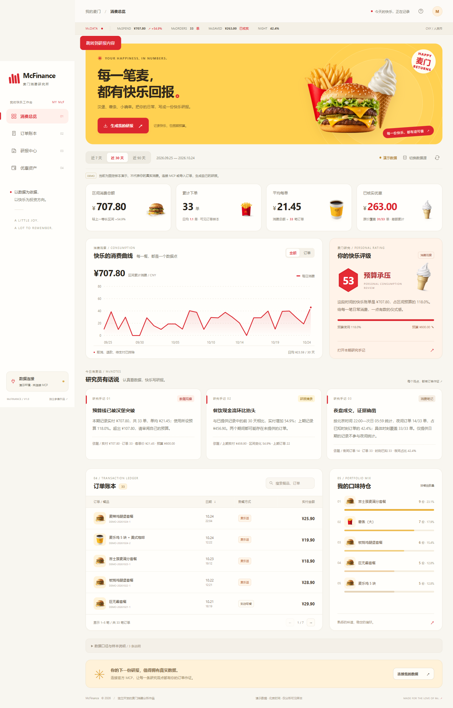

# McFinance · 麦门财报

把自己的麦当劳历史订单，变成一份有数据、有金句、能分享的个人消费研报。

McFinance 通过麦当劳 MCP 的 `order-list` 只读查询历史订单，计算消费金额、客单价、偏好与预算进度，再用轻松的券商研报语气解释自己的消费习惯。例如：“本期第一重仓品种已出炉，研究员建议先看预算再看菜单。” 每条结论都应能回到订单数据；金融术语只用于趣味表达。

这是独立开发的参赛作品，非麦当劳官方产品。幽默针对自己的消费习惯与研报黑话，不评价或贬低品牌、产品。项目不提供投资、医疗或营养建议。

原创代码采用 [MIT License](LICENSE)；第三方图片、商标和官方声明的范围见 [素材说明](ASSET_NOTICES.md)。



## 适合谁

- 想复盘个人消费、检查预算的麦当劳用户。
- 想生成一张个人消费分享卡，又不希望暴露订单详情的人。
- 想把真实 MCP 查询结果接到可视化应用或 Skill 的开发者。

## 已实现的体验

- 奶油白、红黄配色的食物主题仪表盘，支持 7 / 30 / 90 天观察窗口与个人预算。
- 汉堡、薯条、冰淇淋主视觉，以及官网食物图片；素材来源见 [图片记录](docs/PRODUCT_IMAGE_SOURCES.md) 与 [主视觉生成记录](docs/VISUAL_ASSETS.md)。
- 个人消费 KPI、商品偏好、消费趋势、数据驱动的趣味研报。
- 示例模式、标准 JSON 导入、麦当劳 MCP 真实账户只读接入。
- 导出 SVG 分享卡和 Markdown 研报。
- 可安装的 [McFinance Skill](skills/mcfinance/SKILL.md)，可在支持 Skill 与 MCP 的客户端使用。

可先查看用默认示例数据生成的 [SVG 分享卡](docs/example-card.svg) 和 [完整 Markdown 研报](docs/example-report.md)。它们均明确标记为示例，不包含个人订单。

**状态说明：** 已于 2026-10-24 使用本人授权的 MCP Token 完成真实只读联调，验证订单、积分与优惠券查询，并适配实际返回字段。公开样例与截图仍全部使用演示数据；Token 和个人订单不进入源码包。验证范围与限制见 [接入与验证说明](MCP_INTEGRATION.md) 和 [联调记录](docs/LIVE_VALIDATION.md)。

## 本地启动

需要 Node.js 24 或以上版本。项目使用 Node 内置模块，不需要安装第三方依赖。

Windows 用户也可以直接双击根目录的 `start.cmd`，再打开终端显示的本地地址。

```powershell
# 在项目目录运行（Windows）
npm.cmd start

# 或直接运行，适用于 Windows / macOS / Linux
node server.js
```

浏览器打开 [http://127.0.0.1:3210](http://127.0.0.1:3210)。服务默认仅监听本机。示例数据的观察日固定为 **2026-10-24（北京时间）**，方便演示与复核；真实账户报告使用实际查询时间。

运行自动化检查：

```powershell
npm.cmd test
# 或 node --test
```

已通过 47 项 Node 自动化测试，并使用真实浏览器验证周期切换、预算调整、订单搜索和分页、导入校验、带图片的 SVG 导出与失败恢复。可选的浏览器回归脚本为 `python -X utf8 tests/browser_smoke.py`，需先运行独立的无凭证服务并安装 Python Playwright 及 Chromium；也可用 `MCFINANCE_BROWSER` 指定本机 Chrome 路径。已同步真实数据的本机服务可用 `python -X utf8 tests/live_browser.py` 验证，个人导出只写入被忽略的 `private-data/`。真实账号联调与合成数据回归分开验证，公开截图均为演示数据。

## 三种数据入口

**示例体验：** 启动后直接查看示例报告，切换天数、修改预算，再导出分享卡或研报。页面及导出内容会标识数据来源。

**导入 JSON：** 使用“切换数据源 → 导入订单”，选择标准订单 JSON。可以先用 [示例订单](docs/demo-orders.json) 熟悉格式；该文件导入和导出时都会标记为示例。导入只是读取用户选定的数据，不会替用户查询账户。观察日默认为文件中的 `asOf`，未提供时取订单中最晚日期。

```json
{
  "orders": [
    {
      "id": "sample-001",
      "orderedAt": "2026-10-24T12:15:00+08:00",
      "paid": 25.9,
      "original": 35,
      "items": [{ "name": "巨无霸", "quantity": 1 }],
      "channel": "到店",
      "status": "completed"
    }
  ]
}
```

金额单位为人民币元；`original` 不明时填 `null`。不要用零代替未知金额，也不要把“原价与实付的差额”描述为已核验的优惠券收益。完整数据口径见 [数据说明](docs/DATA.md)。

**真实 MCP：** 在 [麦当劳 MCP 开放平台](https://open.mcd.cn/mcp) 登录并自行激活 Token。可通过页面连接入口输入 Token，或在启动服务前设置环境变量：

```powershell
# 当前 PowerShell 进程；将占位符替换为你自己的 Token
$env:MCD_MCP_TOKEN = '<YOUR_MCP_TOKEN>'
node server.js
```

也可复制 `.env.example` 为本地 `.env` 后填写，再执行 `node --env-file=.env server.js`。Token 仅供本机服务调用固定官方 MCP 地址使用；请勿写进 Skill、截图、仓库或分享内容。只在自己的可信设备上启动服务。

连接后先读取服务端工具清单与参数 schema，确认 `order-list` 的当前参数，再按界面要求同步。上游可能只返回近期订单或部分分页数据；报告以实际拿到的数据为准，不承诺完整账户账单。可用范围取决于 Token 权限、接口返回与服务状态。

## 安装 Skill

将整个 `skills/mcfinance` 文件夹复制到客户端的技能目录。Codex 用户可复制到自己的 `~/.codex/skills/mcfinance`，重新加载客户端后使用：

```text
用 McFinance 分析我最近 30 天的麦当劳订单，预算 600 元。
给我一份有数据依据的趣味消费研报，并生成一张不含订单号的 SVG 分享卡。
```

Skill 是独立的指令包；真实查询还需要在目标客户端配置麦当劳 MCP。配置样例为 [mcp-config.example.json](mcp-config.example.json)。`${MCD_MCP_TOKEN}` 代表环境变量占位符，各客户端解析方式不同，请使用客户端支持的环境变量或密钥设置，不要把这个占位符直接当作 Token。

## 参赛材料

- [MCP_INTEGRATION.md](MCP_INTEGRATION.md)：实际接入方式、只读工具范围、验证步骤与已知限制。
- [CONTEST_DECLARATION.md](CONTEST_DECLARATION.md)：官方原文，未修改；校验信息见 [官方来源记录](docs/OFFICIAL_SOURCES.md)。
- [docs/SUBMISSION.md](docs/SUBMISSION.md)：参赛前检查与可复制的报名 Issue 文本。

按核查时的 [官方规则](https://github.com/M-China/mcd-developer-innovation-challenge/blob/main/activityGuidelines.md)，报名截止为 **2026-10-25 23:59（北京时间）**，作品必须真实使用麦当劳 MCP。开发过程中未使用 WorkBuddy，因此没有虚构 `workbuddy.md`。

**报名状态：** 项目已公开发布，并于 2026-10-24 提交 [官方报名 Issue #1275](https://github.com/M-China/mcd-developer-innovation-challenge/issues/1275)，等待官方校验回复。创建 Issue 尚不代表确认参赛成功。

